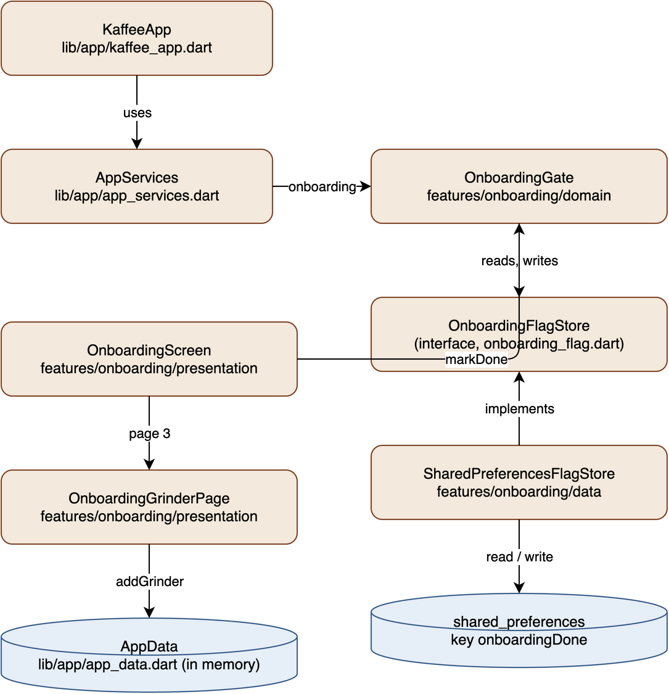
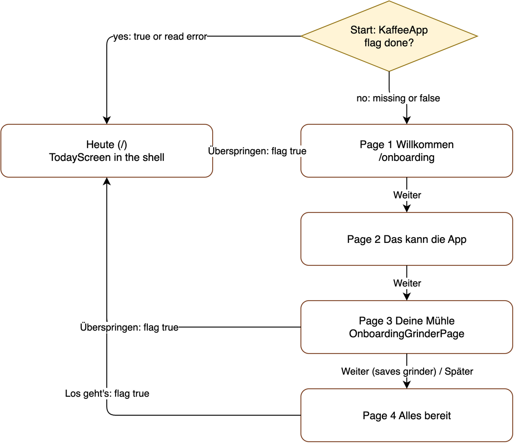
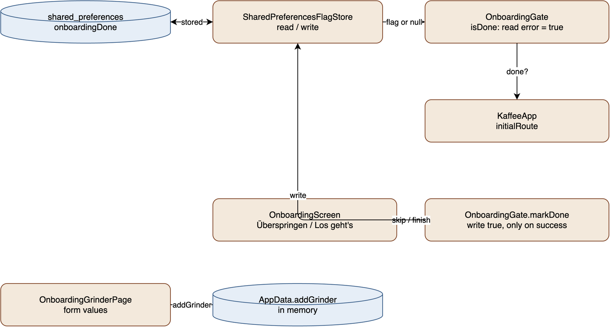

# Kaffee-Begleiter

Flutter app (Android, iOS; Chrome for testing) that guides coffee lovers through
brewing, beans, water and care. One user, no login, fully offline. The
specification is in `SPEC.md`.

## Run and test

Use a Flutter 3.50 SDK, then from this folder:

```sh
flutter pub get
flutter run -d chrome        # or an Android emulator
flutter analyze
flutter test
dart format --set-exit-if-changed .
dart run tool/check_lines.dart
```

Web build for the system tests (bundles CanvasKit, no CDN access needed):
`flutter build web --no-web-resources-cdn`. Web uses hash URLs, so every
route below works as `http://host/#/beans`.

## Folder layout

```
lib/app/            shell (bottom bar, rail, sidebar), router, routes, root widget
lib/core/theme/     tokens.dart (all colours, sizes, radii, type, breakpoints), themes
lib/core/widgets/   AppButton, AppCard, AppField, AppChip, AppBanner, EmptyState,
                    ComingSoon, RuleSourceLabel, ...
lib/core/format/    AppFormat: dates and decimals per language
lib/core/data/      record store behind an interface (backend)
lib/core/rules/     data-driven rules with source and retrieval date (backend)
lib/features/<feature>/presentation/   screens (data/domain follow per story)
lib/l10n/           app_en.arb, app_de.arb and generated app_localizations*.dart
assets/             water, rest, care, brew rule JSON
test/               mirrors lib/
tool/               check_lines.dart
```

## Localization

German (`de`) and English (`en`), chosen from the system language; every other
language falls back to English (`localeResolutionCallback`). All German
variants (de_CH, de_DE, ...) use `dd.MM.yyyy` (16.11.2026); English uses
`d MMM yyyy` (16 Nov 2026). The decimal separator is always a point. Edit the
`.arb` files in `lib/l10n`; `flutter pub get` regenerates the Dart files
(`flutter gen-l10n`). Generated files are exempt from the line check and the
analyzer.

## Design tokens

`lib/core/theme/tokens.dart` is the only place for colour, size, spacing,
radius, type-size, breakpoint and duration values; widgets reference it.
`test/core/theme/no_literals_test.dart` scans `lib/` for violations and
`test/core/theme/contrast_test.dart` checks text contrast (>= 4.5:1) for
success, warning, error and onSurface on `surface` and `surfaceVariant` in
light and dark. Themes follow the system brightness; dark cards have a 1 dp
border instead of a shadow.

## Style guide

Route `/styleguide` (linked from Settings and More) shows every component in
every state (hover, pressed and focus are rendered statically). Tiles carry
keys such as `sg-button-hover`.

## Routes

`/` Today, `/beans`, `/brews`, `/equipment`, `/more`, `/water`, `/care`,
`/settings`, `/styleguide`, `/onboarding` (first start only), plus `/beans/detail`, `/beans/new`, `/brews/new`,
`/brews/detail`, `/filter`, `/equipment/grinder/new`,
`/equipment/machine/new`, `/water/new`; S2 adds `/equipment/grinder/edit`,
`/equipment/machine/edit`, `/water/detail` and `/water/edit` (record id as
route argument). Navigation items have keys
`nav-today`, `nav-beans`, `nav-brews`, `nav-equipment`, `nav-more` (phone,
tablet) and `nav-water`, `nav-care`, `nav-settings` (desktop sidebar).
Layout: phone < 600 dp bottom bar (5), tablet 600-1023 dp rail (5), desktop
>= 1024 dp fixed 240 dp sidebar (7).

## Equipment, water and settings (COF-46)

- Ausrüstung: tabs Mühlen and Maschinen. Grinder cards (88 dp) show the 270
  degree dial arc with scale min/max labels, dead space ("2.5 g") and the scale
  ("1–30 · 0.5"). There is no grind setting yet, so the arc shows the track only.
  Machine cards show the 56 dp ring with the portafilter icon, "93 °C · 8 s"
  and the days to backflush; without a care event the ring is full ("7 days";
  green above 2 days, amber 1-2, red 0 or less). Cards open the edit form;
  the trash button soft-deletes.
- Grinder form: name, scale min/max/step, finer direction, dead space and a
  test field "Check grind setting" that shows the error text of
  `grindSettingErrorText` (SPEC section 5) via `GrinderScale.validate`.
- Machine form: name, brew temperature, pre-infusion, pressure profile and a
  default water profile dropdown (live profiles only).
- Wasser: profile cards (hardness in the selected unit, SCA status chip), detail
  with the "Check water first" hint (R2), "n of 6 measured" and one bar per
  parameter with the marked SCA range (error colour outside, success inside,
  "not measured" for empty values). The form takes hardness in °fH, °dH or ppm
  (R1, stored as ppm, range 0-1000 ppm) and optional alkalinity, TDS, pH,
  sodium, chlorine; both `.` and `,` are accepted as decimal input.
- Einstellungen: hardness unit selector (bound to `AppData.setHardnessUnit`);
  export and import show a "Coming soon" notice.
- State is in memory (`AppData`, provided by `AppScope`); data is lost on
  restart until persistence arrives. Deleted records leave the lists but stay
  resolvable by id.
- Numbers use a decimal point in both languages (`AppFormat.plain` / `parse`);
  units g, s, °C, °fH are the same in German.
- Tests: `test/features/equipment`, `test/features/water`,
  `test/features/settings` (forms, validation, empty states in DE and EN,
  deletion, unit switch), plus format and domain tests.

## Beans, packs and rest time (COF-47)

- **Beans** (`/beans`): cards sorted by the earliest ready date of their packs.
  Each card has a gradient image area (hue `15 + fnv1a32(lowercase(name)) mod 36`),
  a bean icon, roast dots (light 1 ... dark 4), a readiness chip
  (Ready / Resting, N days left / Too old) and the remaining grams.
- **Rest time (R3)**: `readyDate = roastDate + rest days` from
  `assets/rest_rules.json` (espresso blend and all-round use the espresso rest
  time, filter the filter rest time); a pack is too old from `roastDate + 45` days.
- **Forms**: bean (name 1-60, roast level, kind, lead time, optional minimum
  stock) with the first pack (roast date as `dd.MM.yyyy` / `d MMM yyyy` or ISO,
  weight 50-5000 g); pack form; errors shown per field.
- **Detail** (`/beans/detail`): key figures, pack list, "Add pack", "Open"
  (sets `openedAt`), edit and soft delete.
- Data stays in memory (see the data layer note).

## Brews, form, detail and advice (COF-48)

- **List** (`/brews`): "Start filter" entry plus a lazy `ListView.builder` with
  a fixed row extent (88 dp card, 12 dp gap), newest brew first. Each card has
  the bean gradient with a cup icon, the method ("Espresso"), the bean name,
  the shot time ("27 s") and the rating ("★ 4"); tap opens the detail. Empty
  state: cup icon, "No brews yet", "Log your first shot.", "Log a brew".
  `test/features/brews/brews_performance_test.dart` builds 1000 brews and times
  120 scroll frames (build, layout, paint in the test binding): average about
  3 ms, worst about 5 ms in debug mode, asserted below the 16 ms budget; it also
  asserts that fewer than 30 cards are built.
- **Form** (`/brews/new`, optional argument: id of a brew to take over):
  espresso only for now (other methods follow with the filter story). Machine,
  grinder, pack (bean, roast date, grams left) and water dropdowns (water
  defaults to the machine's default profile), grind setting as stepper (minus
  and plus move one scale step, snapped to the grid and clamped to the ends,
  also typed), dose 5-40 g, purge 0-50 g, yield 1-4 x dose, shot time 1-120 s,
  taste chips, 1-5 stars, note. Errors per field use "Enter a value between
  {min} and {max}"; a grind setting off the scale shows the S2 scale error.
  Banners on top: "Add a grinder first", "Add a machine first", "Add a pack
  first" (save does nothing until fixed) and the R7 purge hint ("Grind and
  discard 2.5 g first", reason bean change or idle 24 h or more) which also
  prefills the purge field with the grinder's dead space. Not enough beans in
  the pack shows "Not enough beans in the pack (N g left)" under the dose.
- **Shot timer**: "Start timer" runs a `Ticker`; the elapsed whole seconds are
  written into the shot time field every second, "Stop timer" rounds to the
  nearest second. The field stays editable by hand. Tests drive it with
  `tester.pump(Duration(seconds: 27))`.
- **Detail** (`/brews/detail`, argument: brew id): header band, key figure tiles
  in two columns (setting, dose, purge, yield, ratio, time, taste, rating,
  grinder, machine, water, start date and time), the "Recommendation" card
  and "Next try". Soft delete (stock is not refunded).
- **Recommendation (R9)**: one sentence from `AppData.recommendFor`: "Set grind
  to 11.5", "No change", "Grind stays at 1.0" with the hint "End of scale",
  "Check water first: hardness 300 ppm, SCA 50-175 ppm", "Let the pack rest (N
  days left)" or "Enter water values"; below it the reason (with the number of
  steps and finer or coarser) and the source (URL as link-style text, or
  "Default without source"). "Next try" opens the form with the same machine,
  grinder, pack, dose, purge, yield and water; the grind setting follows the
  recommendation (otherwise the current one); taste, rating and time start
  empty. Grind settings show one decimal (12.0, 11.5).
- Data stays in memory (see the data layer note).
- Tests: `test/features/brews` (list, form, detail, performance).

## Guided filter (COF-49)

Route `/filter` ("Start filter" on Brew; "Next try" of a filter brew opens it
prefilled with argument = brew id). One screen, three phases
(`lib/features/brews/presentation/filter`):

1. Setup: method chips (V60, Chemex, Kalita, AeroPress, Batch; all but V60 show
   "V60 scheme" and "Default without source"), grinder, grind setting, pack,
   water profile, dose (5-40 g) and a ratio slider 1:14-1:18 in 0.5 steps
   (default 1:16) with the live line "Total water: 320 g" (R10). The pack list
   holds only packs that finished the filter rest time and are not too old
   (R3); an espresso blend appears, marked "backup", only if nothing else is
   ready. Without a ready pack Start is disabled.
2. Focus mode: full screen, no navigation or app bar; timer digits 72 sp,
   target "Pour to 40 g" (then 120, 220, 320) at 48 sp, one filled "Next"
   button and "Cancel". The timer runs from Start (frame ticker); "Next"
   advances manually. When a step ends (the planned time of the next step; for
   the last step the lower target time 3:00) `StepFeedback` fires once: on
   Android/iOS `HapticFeedback.mediumImpact` and `SystemSound.alert`; on the
   web only a 300 ms flash in primary at 20 % alpha, no haptics or sound.
   Tests inject a fake `StepFeedback`.
3. Finish: drawdown time (1-600 s, prefilled from the timer), taste, rating;
   "Save" logs the brew (filter fields, pack stock minus dose) and opens its
   detail, which shows water total, bloom, ratio, drawdown, pours and the R11
   advice (one grind sentence, e.g. "Set grind to 20.5").

Tokens for the focus mode live in `lib/core/theme/focus_tokens.dart`.
Tests: `test/features/brews/filter`.

## Stock, care, Heute and export/import (COF-50)

- **Stock (R4/R5)**: consumption per day = grams (dose + purge) of the last
  28 days / 28; minimum stock = bean value or 2 days of consumption (100 g
  without history); order point = consumption x (lead time + rest days) +
  minimum stock. At or below it the bean detail shows "Order now". The
  Bestands-Balken (8 dp, marker at 50 % = order point) sits on bean cards and
  the detail.
- **Gap warning (R6)**: with consumption > 0, a banner "No ready coffee from
  {from} to {to}" with the action "Open pack {x}" or "Order now".
- **Care (R8)**: Pflege lists backflush (7 days or 200 shots), descale (30 /
  60 / 90 days by the machine's default water hardness) and grinder cleaning
  (28 days). A task without a recorded event is due immediately; "Done" starts
  the interval (e.g. "In 7 days"). The machine ring on Ausruestung uses the
  same task (green > 2 days, orange 1-2, red <= 0).
- **Heute**: warning banners (gap, order, care due, water outside SCA), "Ready
  now" cards, last brew, FAB "New brew", empty state.
- **Export/import**: Einstellungen exports `coffee-export-YYYY-MM-DD.json`
  (schemaVersion 1, includes deleted records). Chrome downloads the file;
  Android and iOS open the system share sheet with the file (a small native
  method channel in the Android and iOS runners, no plugin needed); if
  sharing fails, the JSON is copied to the clipboard and shown in a dialog. Import takes a file (Chrome) or pasted
  JSON (all platforms): the record with the newer `updatedAt` wins (a newer
  `deletedAt` deletes), records with missing references are skipped and
  counted, an unknown `schemaVersion` is rejected ("File version not
  supported"), and the merge is one all-or-nothing transaction. "Delete all
  data" empties the in-memory store (the only hard delete).
- **Sources**: Einstellungen lists every rule entry with its source URL or
  "Default without source".
- Playwright (`system_test/run_system_test.py`) covers UC1-UC7 and UC9; UC8
  needs a fixed clock and is covered by unit and widget tests.

## Onboarding flag and routing (OE-75)

The persistent flag `onboardingDone` (bool, `shared_preferences`, key
`onboardingDone`, web: `localStorage` `flutter.onboardingDone`) decides the
start route: missing or `false` shows `/onboarding` page 1 (with data already
present too); `true` shows the shell with Heute. A read error counts as `true`
so the app never loops. The flag is written `true` only when onboarding is
finished or skipped ("Überspringen"); a write error keeps the user on the page
with a retry banner. Logic: `lib/features/onboarding/domain` (`OnboardingGate`)
and `data` (`SharedPreferencesFlagStore`); the start gate is in `KaffeeApp`.
All four pages are built: 1 Willkommen, 2 Funktionen, 3 Mühle (grinder form,
Later/Weiter), 4 Fertig (Los geht's). Page 4 is the finish page; the bean form
of R12 is not part of this build. A reload in
Chrome does not show the onboarding again (system test
`system_test/run_system_test.py`).

## Onboarding diagrams (OE-75)

Architecture of the onboarding flag (`docs/diagrams/architecture.drawio`):



Screens and the way from the start to Heute (`docs/diagrams/navigation.drawio`):



Where the flag and the grinder are read and written (`docs/diagrams/data-flow.drawio`):



## Data layer note

drift/SQLite could not be installed offline in this environment, so the data
layer is a pure-Dart record store behind an interface (`lib/core/data`); a
drift implementation can replace it without touching callers.

## Status per story

- COF-45 (design system and app shell): done. Tokens, themes, components,
  responsive shell, all screens reachable (later-story screens show "Coming
  soon"), style guide, DE/EN, rule-source label, check_lines, rule assets.
- COF-46 (equipment, water, settings): done. Grinder and machine lists and
  forms, water list, detail and form with the SCA check, hardness unit
  setting, in-memory store, R1 and R2, DE/EN.
- COF-47 (beans, packs, rest time): done.
- COF-48 (brews list, form, detail, shot timer, R7 and R9 advice): done.
- COF-49 (guided filter, R10, R11, pack suggestion): done.
- COF-50 (stock, care, Heute, export/import, sources): done.
- OE-75 (onboarding S1: flag and routing, page 1, skip): done.
- OE-76 (onboarding S2: info pages, progress and navigation): done.
- OE-77 (onboarding S3: first grinder on page 3, Später, Ausrüstung): done.
- Later: persistence (drift/SQLite).
